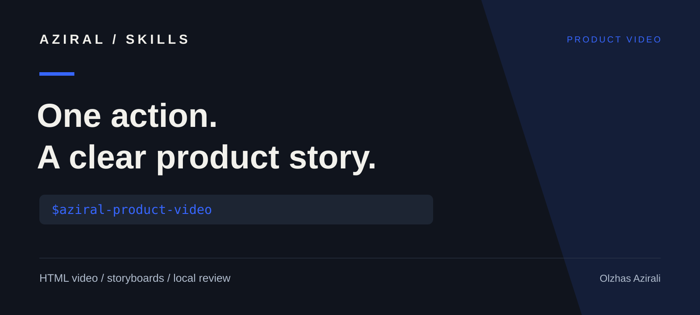

# Навыки AZIRAL для HyperFrames

Независимый набор инструкций от **Олжаса Азирали / AZIRAL**. Проект не связан с HeyGen, не поддерживается HeyGen и не является официальным пакетом HyperFrames.



Навык помогает показать одно действие в продукте и его результат, опираться на запись экрана и проверенные факты, сохранить читаемость в разных языках и форматах.

[English](README.md)

## Установка

```sh
npx skills add azirali/hyperframes --skill aziral-product-video
```

Команда устанавливает инструкции для выбранного агента. Для рендера отдельно нужен HyperFrames и его зависимости. Настройка описана в [официальном руководстве HeyGen](https://hyperframes.heygen.com/quickstart).

## Что включено

- Оригинальный навык [`aziral-product-video`](skills/aziral-product-video/SKILL.md).
- [Шаблон брифа](skills/aziral-product-video/references/brief-template.md) с источниками, планом кадров и проверкой вариантов.
- [Пример JSON](examples/product-demo/brief.json) с вымышленным продуктом и текстами на русском, английском и казахском.
- [Метаданные для Codex](skills/aziral-product-video/agents/openai.yaml).

Пример предназначен для планирования. Это не готовое приложение или исполняемая композиция. Записи экрана, музыка и видеодвижок в репозиторий не входят.

## Пример запроса

```text
Используй $aziral-product-video и эту запись приложения, чтобы подготовить
раскадровку вертикального ролика на 12 секунд. Покажи одно действие и результат.
Подготовь тексты на русском, английском и казахском. Сохрани читаемость интерфейса
и отметь неподтверждённые утверждения. Пока нужен только план, без озвучки
и платных сервисов.
```

Перевод текста ролика не означает, что приложение поддерживает соответствующий язык.

## Стоимость и публикация

Локальное планирование не требует платного медиасервиса. Для рендера нужна ваша среда HyperFrames. Платная генерация, облачный рендер, подключение аккаунтов и публикация выполняются в рамках указаний пользователя и бюджета.

## Авторство и лицензия

Официальный HyperFrames и исходные навыки: [репозиторий HeyGen](https://github.com/heygen-com/hyperframes). Документация: [hyperframes.heygen.com](https://hyperframes.heygen.com/introduction).

Наш вклад: оригинальный процесс `aziral-product-video`, шаблон брифа и пример на трёх языках. [MIT](LICENSE) распространяется только на оригинальные файлы этого репозитория. Внешние инструменты и материалы сохраняют собственные лицензии и авторство.

Автор: [Олжас Азирали / AZIRAL](https://aziral.com/olzhas-azirali). Предложения по улучшению брифа, читаемости и переводов приветствуются с примером задачи.

## Другие навыки AZIRAL

[Видео с HyperFrames](https://github.com/azirali/hyperframes) · [Промо с Remotion](https://github.com/azirali/remotion) · [Дизайн интерфейсов](https://github.com/azirali/taste-skill) · [Проверка перед выпуском](https://github.com/azirali/impeccable)

Если навык пригодился в работе, звезда поможет другим разработчикам его найти.
